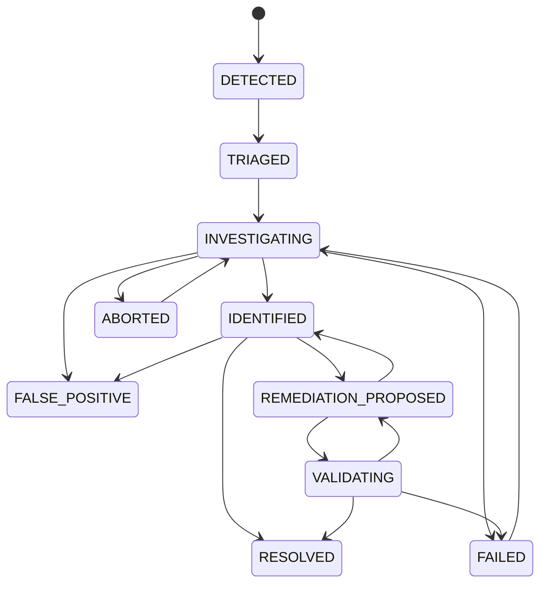

# NEXUS Incident Lifecycle

> **Status:** Conceptual design for Phase 1+. Not implemented in Phase 0.

---

## Lifecycle States

```text
DETECTED → TRIAGED → INVESTIGATING → IDENTIFIED
                                      ↓
                            REMEDIATION_PROPOSED
                                      ↓
                                  VALIDATING
                                      ↓
                                   RESOLVED
```

### Failure / Escape States

- `FAILED` — Investigation could not identify cause; remediation not possible
- `ABORTED` — Investigation stopped by human (e.g., incident resolved externally)
- `FALSE_POSITIVE` — Detection was incorrect; no actual incident

---

## State Definitions

| State | Description | Entry Criteria | Exit Criteria |
|-------|-------------|----------------|---------------|
| `DETECTED` | Automated signal or human report created an incident record | Detection rule fired or user reported | Human triage or auto-triage completes |
| `TRIAGED` | Incident classified, severity assigned, primary service identified | Triage complete (auto or human) | Investigation starts |
| `INVESTIGATING` | Active hypothesis generation, evidence gathering, verification | First hypothesis created or agent started | Diagnosis reached or investigation fails |
| `IDENTIFIED` | Root cause diagnosed with evidence-backed causal chain | Diagnosis recorded with confidence ≥ threshold | Remediation proposed or incident resolved externally |
| `REMEDIATION_PROPOSED` | Patch/config/infra change proposed with test plan | RemediationProposal created and approved | Validation starts in sandbox |
| `VALIDATING` | Remediation running in isolated sandbox (tests, scans, canary) | Sandbox execution started | Sandbox completes (pass/fail) |
| `RESOLVED` | Incident fully resolved; remediation deployed or incident expired | Remediation deployed + verified, or incident auto-resolved | — (terminal) |
| `FAILED` | Investigation exhausted; no diagnosis; no remediation possible | Investigation timeout or explicit abandonment | Human review may reopen |
| `ABORTED` | Investigation stopped before completion | Human abort or superseding event | Human review may reopen |
| `FALSE_POSITIVE` | Detection was erroneous; no real incident | Human or automated determination | — (terminal) |

---

## Valid Transitions



---

## Transition Details

### DETECTED → TRIAGED
- **Auto-triage:** Rule-based classification (severity, service, type) using deterministic intelligence
- **Human triage:** On-call engineer reviews, assigns, enriches
- **Output:** `severity`, `primary_service_id`, `affected_service_ids`, initial `IncidentEvent`

### TRIAGED → INVESTIGATING
- Evidence bundle assembled (deterministic)
- First hypothesis created (human or agent)
- Agent run started (if automated)
- **Output:** `IncidentEvent` with evidence bundle summary

### INVESTIGATING → IDENTIFIED
- Diagnosis recorded with:
  - Root cause type
  - Causal chain with evidence
  - Confidence score
  - Uncertainty rationale (if < 1.0)
- **Output:** `Diagnosis` record, `IncidentEvent`

### INVESTIGATING → FAILED
- All hypotheses exhausted/contradicted
- Time budget exceeded
- No verifiable path forward
- **Output:** `IncidentEvent` with failure reason

### INVESTIGATING → ABORTED
- Human stops investigation (e.g., incident resolved by other means)
- **Output:** `IncidentEvent` with abort reason

### INVESTIGATING → FALSE_POSITIVE
- Evidence shows no actual deviation (e.g., broken alert, instrumentation bug)
- **Output:** `IncidentEvent` with evidence of false positive

### IDENTIFIED → REMEDIATION_PROPOSED
- RemediationProposal created with:
  - Code/config/infra changes
  - Test plan
  - Risk assessment
  - Rollback plan
- Human review required before validation

### IDENTIFIED → RESOLVED (direct)
- Incident resolved without code change (e.g., dependency recovered, traffic spike ended)
- **Output:** `IncidentEvent` with resolution summary

### REMEDIATION_PROPOSED → VALIDATING
- Human approves proposal
- Sandbox provisioned
- RemediationAttempt started

### REMEDIATION_PROPOSED → IDENTIFIED
- Proposal rejected or superseded by new diagnosis
- **Output:** `IncidentEvent` with rejection reason

### VALIDATING → RESOLVED
- Sandbox tests pass
- Security scans pass
- Human approves PR
- PR merged and deployed
- Post-deploy verification passes

### VALIDATING → REMEDIATION_PROPOSED
- Sandbox tests fail or scans find issues
- Proposal revised

### VALIDATING → FAILED
- Sandbox execution failed unrecoverably
- No viable remediation path

### FAILED / ABORTED → INVESTIGATING (Reopen)
- New evidence emerges
- Human requests re-investigation
- **Requires:** Explicit reopen action with reason

---

## Investigation Completed ≠ Incident Resolved

**Critical distinction:**

- `IDENTIFIED` = Investigation completed (cause known)
- `RESOLVED` = Incident actually fixed (remediation deployed and verified)

An identified cause does **not** imply the incident has been fixed. The gap between `IDENTIFIED` and `RESOLVED` is where remediation lives.

---

## Retry / Reopen Considerations

- **Reopen from RESOLVED:** Only if regression detected within configured window (e.g., 24h). Creates new incident linked to original.
- **Reopen from FAILED/ABORTED:** Allowed with new evidence or human request. Preserves original investigation trace.
- **Reopen from FALSE_POSITIVE:** Not allowed. Create new incident if symptoms reappear.
- **Maximum investigation time:** Configurable per severity (e.g., SEV1: 4h, SEV2: 8h, SEV3: 24h). After timeout → `FAILED` unless extended by human.

---

## Audit Trail

Every state transition creates an `IncidentEvent` with:
- `event_type` (matches transition)
- `actor_type` (system, human, agent)
- `actor_id`
- `payload` (structured data: hypothesis ID, diagnosis ID, evidence IDs, etc.)
- `created_at` (UTC)

Full history is queryable and replayable.