# NEXUS System Architecture

> **Status:** All components marked **PLANNED** or **DESIGNED**. None are **IMPLEMENTED** in Phase 0.

## High-Level Architecture

```mermaid
flowchart TD
    subgraph Sources["Sources & Collection"]
        A1["Applications\n(OpenTelemetry)"]
        A2["Git Provider\n(commits, PRs)"]
        A3["CI/CD Systems\n(deployments, builds)"]
    end

    subgraph Ingestion["Ingestion / Normalization (PLANNED)"]
        B1["Validate"]
        B2["Normalize"]
        B3["Enrich & Timestamp"]
    end

    subgraph Storage["Storage Layer (PLANNED)"]
        C1["Telemetry Storage\n(logs, metrics, traces)"]
        C2["Application State\n(projects, services, incidents,\nhypotheses, evidence, eval records)"]
    end

    subgraph Intelligence["Deterministic Evidence Intelligence (PLANNED)"]
        D1["Query Execution"]
        D2["Time-Window Alignment"]
        D3["Deployment Correlation"]
        D4["Service/Dependency Lookups"]
        D5["Baseline Calculations"]
    end

    subgraph Investigation["Incident Investigation (PLANNED)"]
        E1["Structured Evidence Bundle"]
        E2["Hypothesis Generation"]
        E3["Tool Selection & Execution"]
        E4["Verification"]
        E5["Final Diagnosis"]
    end

    subgraph UI["User Interface (PLANNED)"]
        F1["Incident Timeline"]
        F2["Evidence/Source Links"]
        F3["Service Topology"]
        F4["Deployment Comparisons"]
        F5["Investigation Journal"]
        F6["Remediation Review"]
    end

    subgraph Evaluation["Evaluation (PLANNED)"]
        G1["Frozen Scenarios"]
        G2["Repeatable Runs"]
        G3["Regression Comparison"]
        G4["Correctness, Grounding,\nUncertainty, Latency, Cost"]
    end

    subgraph Remediation["Remediation (FUTURE)"]
        H1["Isolated Workspace"]
        H2["Constrained Execution"]
        H3["Tests/Scans"]
        H4["Artifacts"]
        H5["Human Approval Gate"]
    end

    Sources --> Ingestion
    Ingestion --> Storage
    Storage --> Intelligence
    Intelligence --> Investigation
    Investigation --> UI
    Investigation --> Evaluation
    Investigation --> Remediation
    Evaluation --> UI
    Remediation --> UI
```



## Component Descriptions

### 1. Sources and Collection (PLANNED)

Applications instrumented with OpenTelemetry emit traces, metrics, and logs. Git providers (GitHub, GitLab) and CI/CD systems (GitHub Actions, GitLab CI, Jenkins) emit commit, pull request, deployment, and build events.

**Inputs:** OTLP/gRPC, HTTP, webhook payloads
**Outputs:** Validated, normalized events to ingestion pipeline

### 2. Ingestion / Normalization (PLANNED)

Validates incoming payloads against schemas, normalizes field names and types, assigns canonical timestamps (UTC), enriches with service/environment metadata, and forwards to storage.

**Guarantees:** Schema validation, idempotent writes, ordering within partition
**Failure modes:** Schema rejection, enrichment lookup failure, backpressure

### 3. Telemetry Storage (PLANNED)

Analytical storage for logs, metrics, and traces. Optimized for time-range queries, service/operation filtering, and trace root-cause traversal. Technology undecided — candidates include ClickHouse, TimescaleDB, or columnar object store.

**Not an application-state store.** Does not store incidents, hypotheses, or evaluation records.

### 4. Application State (PLANNED)

Relational store for entities that require transactional consistency and complex relationships: projects, environments, services, deployments, commits, incidents, incident events, hypotheses, evidence references, agent runs, tool calls, evaluation cases, and evaluation results.

**Source of truth** for investigation workflow state. Telemetry records remain in telemetry storage.

### 5. Deterministic Evidence Intelligence (PLANNED)

Pure functions (no model calls) that execute:

- Time-window alignment across telemetry and state changes
- Deployment/commit correlation with symptom onset
- Service/dependency graph lookups
- Baseline calculations (error rate, latency, throughput)
- Signal extraction (anomalies, thresholds, rate-of-change)

**Key principle:** Deterministic systems do deterministic work. This layer produces evidence, not conclusions.

### 6. Incident Investigation (PLANNED)

Bounded, auditable investigation workflow:

1. **Evidence bundle assembly** — deterministic retrieval of relevant telemetry, deployments, commits, runbooks, historical incidents
2. **Hypothesis generation** — model proposes falsifiable explanations, each linked to evidence
3. **Tool selection** — model selects from read-only tools (query logs, fetch trace, get deployment diff, search runbooks)
4. **Verification** — tools execute, results validated, evidence updated
5. **Diagnosis** — structured conclusion with causal chain, supporting/contradicting evidence, uncertainty

**All tool results verified.** Model cannot invent evidence IDs or strengthen observations.

### 7. User Interface (PLANNED)

- Incident timeline with correlated events
- Evidence cards with source links (trace ID, commit SHA, runbook URL)
- Service topology with dependency edges
- Deployment comparison (before/after config, code, infra)
- Investigation journal (hypothesis → tool → result → updated belief)
- Remediation review (diff, test results, scan output, approval)

### 8. Evaluation (PLANNED)

Frozen incident scenarios (benchmarks) with:

- Repeatable runs across model/prompt/tool versions
- Regression detection on structured metrics
- Measures: detection, localization, root-cause accuracy, change attribution, evidence grounding, supporting/contradicting coverage, causal correctness, false attribution, abstention quality, tool efficiency, latency, cost
- Human review for prose quality

**Frozen snapshots:** Investigator sees only data available at incident cutoff. No ground-truth leakage.

### 9. Remediation (FUTURE — Phase 7+)

- Isolated workspace (container/VM, no production network)
- Constrained execution: apply patch, run tests, lint, type-check, security scan
- Artifacts stored (logs, coverage, SBOM)
- Human approval required before PR creation
- No `production.execute` or `production.mutate` capabilities

## Data Flow Summary

```
Application/Git/CI
       ↓
Collection & Ingestion (validate, normalize, enrich)
       ↓
Telemetry Storage + Application State (separate stores)
       ↓
Deterministic Evidence Intelligence (correlation, baselines)
       ↓
Evidence Bundle + Hypotheses → Bounded AI Investigation
       ↓
Evidence-Backed Diagnosis OR Explicit Uncertainty
       ↓
Human-Reviewed Remediation Proposal → Sandbox Validation → PR
```

## Phased Implementation

| Phase | Focus | Key Deliverables |
|-------|-------|------------------|
| 0 | Foundation & Benchmark | Docs, schemas, 20+ cases, validator, tests, CI |
| 1 | Demo App & Telemetry | Instrumented services, fault injection, local OTel |
| 2 | Evidence Storage & Correlation | Persisted telemetry/state, deterministic queries |
| 3 | Detection & UI | Incident candidates, timeline, topology, evidence links |
| 4 | Read-Only AI Investigator | Structured workflow, read-only tools, audit trail |
| 5 | Diagnosis & Memory | Code symbols, commits, runbooks, history, uncertainty |
| 6 | Evaluation Hardening | Expanded benchmarks, regression testing, cost/latency |
| 7 | Sandboxed Remediation | Patch gen, test execution, scan, human approval → PR |
| 8 | Git Integration | Scoped app, auditability, credential management |
| 9 | Self-Observability | NEXUS-on-NEXUS, memory maintenance, predictive insights |

## Decisions Recorded in ADRs

- [ADR-0001: Evidence-First Architecture](decisions/ADR-0001-evidence-first-architecture.md)
- [ADR-0002: Benchmark Format](decisions/ADR-0002-benchmark-format.md)
- [ADR-0003: Modular Monolith First](decisions/ADR-0003-modular-monolith-first.md)
- [ADR-0004: Read-Only Investigation](decisions/ADR-0004-read-only-investigation.md)
- [ADR-0005: Frozen Benchmark Snapshots](decisions/ADR-0005-frozen-benchmark-snapshots.md)
- [ADR-0006: Telemetry & State Store Criteria](decisions/ADR-0006-telemetry-state-store-criteria.md)
- [ADR-0007: Product Naming](decisions/ADR-0007-product-naming.md)

## Open Questions

1. Telemetry storage technology (ClickHouse vs TimescaleDB vs object store) — Phase 1 measurement required
2. Application state DB (PostgreSQL vs SQLite for embedded) — Phase 1 prototype
3. Model provider abstraction — Phase 4
4. Sandbox isolation mechanism (gVisor, Firecracker, container) — Phase 7
5. Multi-tenancy model — post-Phase 3